# Relatório de Bugs — Calculadora Científica (Parada Obrigatória 2)

**Arquivo analisado:** `Calculadora.py`
**Data de identificação de todos os bugs:** 06/11/2026
**Evidências:** pasta `evidencias/`

## Ambiente de teste

- Sistema: Windows, terminal PowerShell
- Execução: `python Calculadora.py` dentro de um ambiente virtual (`venv`)
- Dependência: NumPy
- Versões: Python 3.12.0 · NumPy v2.5.4

## Legenda de severidade

- **Crítico:** a operação retorna um valor errado sem nenhum aviso, em uma função básica.
- **Alto:** a operação falha por completo ou retorna um resultado incorreto.
- **Médio:** o programa quebra ou retorna um valor inválido em uma entrada fora do esperado.
- **Baixo:** problema cosmético ou de impacto pequeno.

## Resumo

| ID | Título | Severidade | Status | Evidência |
|---|---|---|---|---|
| BUG-01 | Adição retorna 2x + y | Crítico | Não resolvido | `Bug_soma.png` |
| BUG-02 | Fatorial retorna sempre 0 | Alto | Não resolvido | `Bug_fatorial_Zero.png` |
| BUG-03 | Fatorial aceita número negativo | Médio | Não resolvido | `Bug_fatorial_Negativo.png` |
| BUG-04 | Logaritmo natural chama função inexistente (`np.ln`) | Alto | Não resolvido | `Bug_log_attributeError.png` |
| BUG-05 | Logaritmo base 10 calcula o logaritmo natural | Alto | Não resolvido | `Bug_log10_Errado.png` |
| BUG-06 | Logaritmo base 10 aceita zero e retorna `-inf` | Médio | Não resolvido | `Bug_log10_inf.png` |
| BUG-07 | Divisão por zero sem tratamento | Médio | Não resolvido | `Bug_divisao_zeroDivisorError.png` |
| BUG-08 | Potência com base negativa e expoente fracionário retorna `nan` | Médio | Não resolvido | `Bug_pow_nan.png` |
| BUG-09 | Seno listado no menu, mas não implementado | Alto | Não resolvido | `Bug_seno_invalido.png` |
| BUG-10 | Cosseno chama função inexistente | Alto | Não resolvido | `Bug_cosseno_notDefined.png` |
| BUG-11 | Tangente chama função inexistente | Alto | Não resolvido | `Bug_tang_notDefined.png` |
| BUG-12 | Entrada não numérica encerra o programa com erro | Médio | Não resolvido | `Bug_errorNoFloat.png` |
| BUG-13 | Importar o módulo executa a calculadora | Médio | Não resolvido | `Bug_OSError.png` |

---

## BUG-01 — Adição retorna 2x + y

### Identificação
- **Título:** Adição retorna 2x + y em vez de x + y
- **Localização:** `Calculadora.py`, função `adicao` (linha 4)

### Descrição detalhada
- **Descrição clara:** a função faz `return x + np.add(x, y)`. Como `np.add(x, y)` já é a soma, o resultado é `x + (x + y)`, ou seja, `2x + y`. A operação mais básica da calculadora devolve um valor errado e não mostra nenhum erro, então o usuário não percebe o problema.
- **Contexto:** opção 1 do menu, com os valores 50 e 10. Ver "Ambiente de teste".

### Passos para reproduzir
1. Execute `python Calculadora.py`.
2. Digite `1` (Adição).
3. Digite `50` como primeiro número.
4. Digite `10` como segundo número.
- **Consistência:** ocorre sempre.

### Resultado esperado vs. obtido
- **Esperado:** `Resultado: 60.0`
- **Obtido:** `Resultado: 110.0`

### Evidências
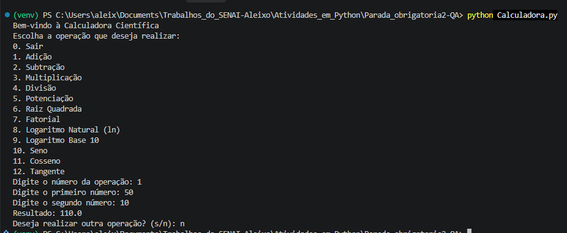

### Severidade e impacto
- **Severidade:** Crítico
- **Impacto:** todo cálculo de adição fica errado, e o erro é silencioso. É o pior tipo de defeito para uma calculadora.

### Sugestões para correção (opcional)
Retornar `x + y` (ou apenas `np.add(x, y)`).

### Registro e acompanhamento
- **Data de identificação:** 06/11/2026
- **Status:** Não resolvido

---

## BUG-02 — Fatorial retorna sempre 0

### Identificação
- **Título:** Fatorial retorna sempre 0
- **Localização:** `Calculadora.py`, função `fatorial` (linha 25, `for i in range(x+1)`)

### Descrição detalhada
- **Descrição clara:** o laço começa em `i = 0`, e `fat *= 0` zera o acumulador na primeira iteração. Para qualquer entrada positiva o resultado é 0.
- **Contexto:** opção 7 do menu, com os valores 50 e 9.

### Passos para reproduzir
1. Execute `python Calculadora.py`.
2. Digite `7` (Fatorial).
3. Digite `9` (repita o teste com `50`).
- **Consistência:** ocorre sempre.

### Resultado esperado vs. obtido
- **Esperado:** `9! = 362880` e `50! ≈ 3,04 × 10^64`
- **Obtido:** `Resultado: 0` nos dois casos

### Evidências
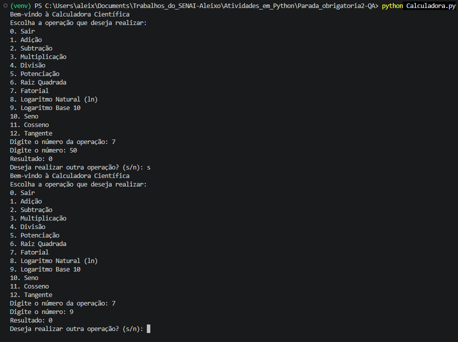

### Severidade e impacto
- **Severidade:** Alto
- **Impacto:** a função não calcula nenhum fatorial correto. Toda entrada maior ou igual a 0 retorna 0, inclusive 0 e 1, cujo fatorial é 1. O erro é silencioso.

### Sugestões para correção (opcional)
Iterar com `range(1, x+1)`.

### Registro e acompanhamento
- **Data de identificação:** 06/11/2026
- **Status:** Não resolvido

---

## BUG-03 — Fatorial aceita número negativo

### Identificação
- **Título:** Fatorial de número negativo retorna 1 em vez de erro
- **Localização:** `Calculadora.py`, função `fatorial` (linhas 23–27, sem validação de entrada)

### Descrição detalhada
- **Descrição clara:** o fatorial não é definido para números negativos, mas a função não valida a entrada. Com `x` negativo, `range(x+1)` fica vazio, o laço não executa e o retorno é o valor inicial `1`.
- **Contexto:** opção 7 do menu, com os valores -10 e -50.

### Passos para reproduzir
1. Execute `python Calculadora.py`.
2. Digite `7` (Fatorial).
3. Digite `-10` (repita com `-50`).
- **Consistência:** ocorre sempre.

### Resultado esperado vs. obtido
- **Esperado:** mensagem de erro, por exemplo `Erro: Fatorial de número negativo`
- **Obtido:** `Resultado: 1`

### Evidências
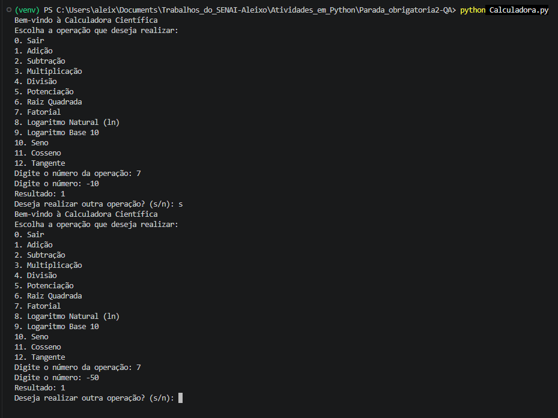

### Severidade e impacto
- **Severidade:** Médio
- **Impacto:** o usuário recebe um resultado matematicamente inválido como se fosse correto.

### Sugestões para correção (opcional)
Validar `x < 0` no início da função e retornar uma mensagem de erro, no mesmo padrão de `raiz_quadrada`.

### Registro e acompanhamento
- **Data de identificação:** 06/11/2026
- **Status:** Não resolvido

---

## BUG-04 — Logaritmo natural chama função inexistente

### Identificação
- **Título:** Logaritmo natural usa `np.ln`, que não existe no NumPy
- **Localização:** `Calculadora.py`, função `logaritmo_natural` (linha 32)

### Descrição detalhada
- **Descrição clara:** o NumPy não tem a função `ln`. O logaritmo natural é `np.log`. Qualquer entrada válida provoca `AttributeError`, e a opção 8 do menu fica inutilizável.
- **Contexto:** opção 8 do menu, com o valor 22.

### Passos para reproduzir
1. Execute `python Calculadora.py`.
2. Digite `8` (Logaritmo Natural).
3. Digite `22`.
- **Consistência:** ocorre sempre.

### Resultado esperado vs. obtido
- **Esperado:** `Resultado: 3.0910424533583156`
- **Obtido:** o programa é encerrado com exceção.

### Evidências
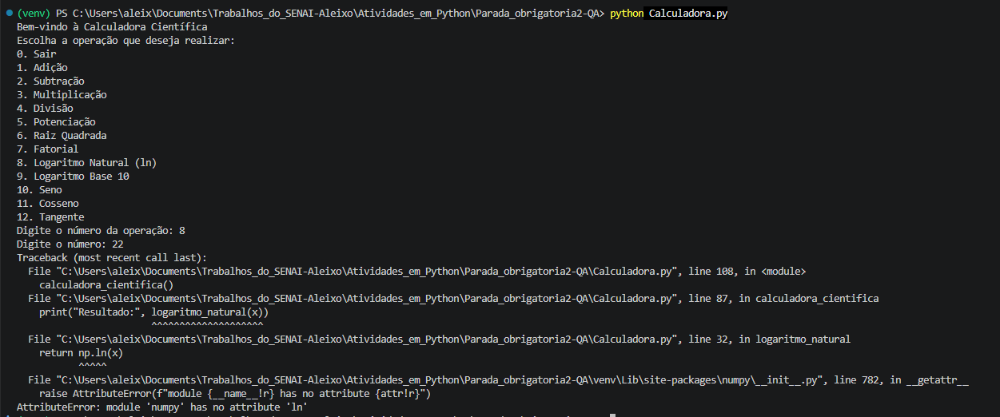

Log de erro:
```
File "...\Calculadora.py", line 32, in logaritmo_natural
    return np.ln(x)
AttributeError: module 'numpy' has no attribute 'ln'
```

### Severidade e impacto
- **Severidade:** Alto
- **Impacto:** a operação não funciona para nenhuma entrada válida, e o programa é encerrado.

### Sugestões para correção (opcional)
Trocar `np.ln(x)` por `np.log(x)`.

### Registro e acompanhamento
- **Data de identificação:** 06/11/2026
- **Status:** Não resolvido

---

## BUG-05 — Logaritmo base 10 calcula o logaritmo natural

### Identificação
- **Título:** Logaritmo base 10 retorna o logaritmo natural
- **Localização:** `Calculadora.py`, função `logaritmo_base10` (linha 37, `return np.log(x)`)

### Descrição detalhada
- **Descrição clara:** `np.log` calcula o logaritmo natural (base e). Para a base 10 é necessário `np.log10`. A opção 9 devolve resultados da base errada, sem nenhum aviso.
- **Contexto:** opção 9 do menu, com os valores 20 e 10.

### Passos para reproduzir
1. Execute `python Calculadora.py`.
2. Digite `9` (Logaritmo Base 10).
3. Digite `10` (repita com `20`).
- **Consistência:** ocorre sempre.

### Resultado esperado vs. obtido
- **Esperado:** `log10(10) = 1.0` e `log10(20) ≈ 1.3010`
- **Obtido:** `2.302585092994046` e `2.995732273553991` (os valores de ln 10 e ln 20)

### Evidências
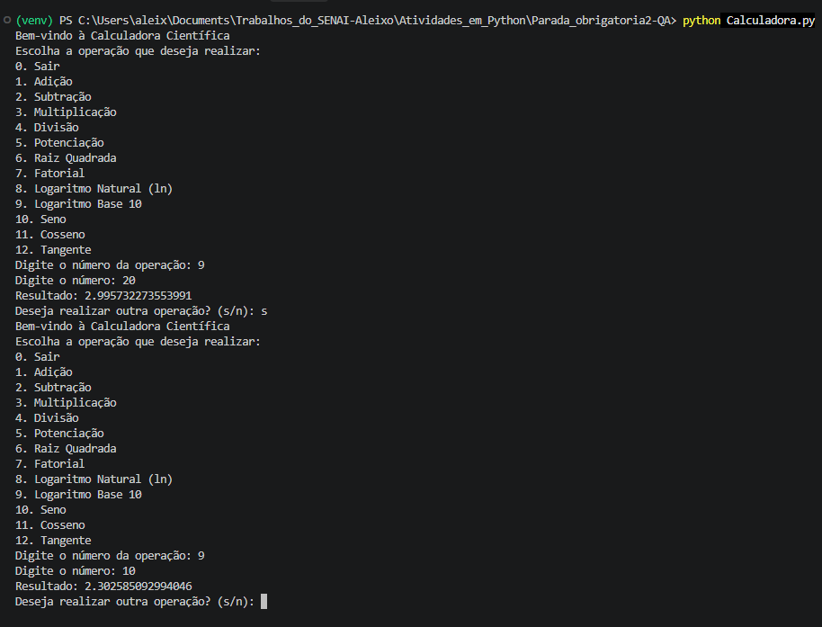

### Severidade e impacto
- **Severidade:** Alto
- **Impacto:** todos os resultados do log10 estão errados, e o erro é silencioso.

### Sugestões para correção (opcional)
Trocar `np.log(x)` por `np.log10(x)`.

### Registro e acompanhamento
- **Data de identificação:** 06/11/2026
- **Status:** Não resolvido

---

## BUG-06 — Logaritmo base 10 aceita zero

### Identificação
- **Título:** Logaritmo base 10 de zero retorna `-inf` com warning
- **Localização:** `Calculadora.py`, função `logaritmo_base10` (linha 35, `if x < 0`)

### Descrição detalhada
- **Descrição clara:** a mensagem de erro diz "número não positivo", mas a condição é `x < 0`, então o zero passa pela validação. O logaritmo de 0 não é definido, e o NumPy devolve `-inf` junto de um `RuntimeWarning`.
- **Contexto:** opção 9 do menu, com o valor 0.

### Passos para reproduzir
1. Execute `python Calculadora.py`.
2. Digite `9` (Logaritmo Base 10).
3. Digite `0`.
- **Consistência:** ocorre sempre.

### Resultado esperado vs. obtido
- **Esperado:** `Erro: Logaritmo de número não positivo`
- **Obtido:** `Resultado: -inf`, com `RuntimeWarning: divide by zero encountered in log`

### Evidências
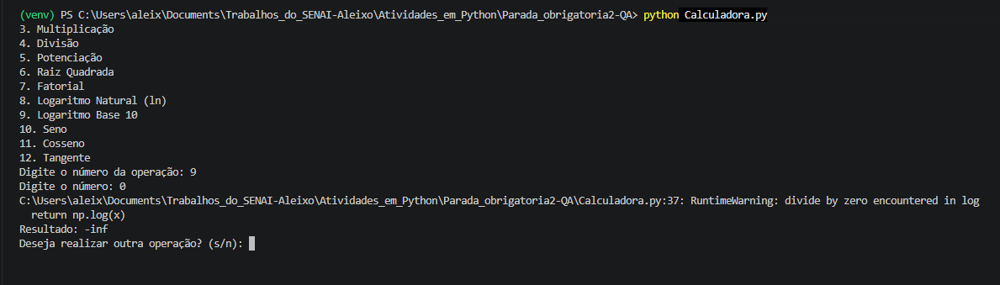

### Severidade e impacto
- **Severidade:** Médio
- **Impacto:** a validação não segue a própria mensagem, e o usuário recebe um valor infinito sem explicação. Em `logaritmo_natural` a mesma validação usa `x <= 0` corretamente.

### Sugestões para correção (opcional)
Trocar a condição para `x <= 0`.

### Registro e acompanhamento
- **Data de identificação:** 06/11/2026
- **Status:** Não resolvido

---

## BUG-07 — Divisão por zero sem tratamento

### Identificação
- **Título:** Divisão por zero encerra o programa com `ZeroDivisionError`
- **Localização:** `Calculadora.py`, função `divisao` (linha 13)

### Descrição detalhada
- **Descrição clara:** a função faz `x / y` sem verificar se `y` é zero. Como os valores digitados são `float`, o Python levanta `ZeroDivisionError` e o programa é encerrado. As outras operações com domínio restrito (raiz quadrada e logaritmos) devolvem uma mensagem de erro, mas a divisão não.
- **Contexto:** opção 4 do menu, com os valores 10 e 0.

### Passos para reproduzir
1. Execute `python Calculadora.py`.
2. Digite `4` (Divisão).
3. Digite `10` como primeiro número.
4. Digite `0` como segundo número.
- **Consistência:** ocorre sempre.

### Resultado esperado vs. obtido
- **Esperado:** mensagem de erro, por exemplo `Erro: Divisão por zero`
- **Obtido:** o programa é encerrado com exceção.

### Evidências
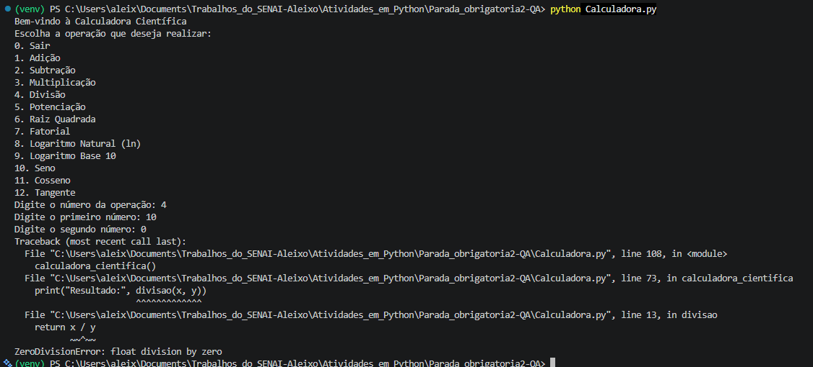

Log de erro:
```
File "...\Calculadora.py", line 13, in divisao
    return x / y
ZeroDivisionError: float division by zero
```

### Severidade e impacto
- **Severidade:** Médio
- **Impacto:** uma entrada comum e previsível derruba a calculadora.

### Sugestões para correção (opcional)
Verificar `if y == 0` e retornar uma mensagem de erro no mesmo padrão das outras funções.

### Registro e acompanhamento
- **Data de identificação:** 06/11/2026
- **Status:** Não resolvido

---

## BUG-08 — Potência com base negativa e expoente fracionário retorna `nan`

### Identificação
- **Título:** Potência de base negativa com expoente fracionário retorna `nan`
- **Localização:** `Calculadora.py`, função `potencia` (linha 16)

### Descrição detalhada
- **Descrição clara:** `np.power` com base negativa e expoente fracionário não tem resultado real. O NumPy devolve `nan` e emite um `RuntimeWarning`, mas a calculadora não trata o caso nem avisa o usuário com uma mensagem clara.
- **Contexto:** opção 5 do menu, com a base -5 e o expoente 0.5.

### Passos para reproduzir
1. Execute `python Calculadora.py`.
2. Digite `5` (Potenciação).
3. Digite `-5` como primeiro número.
4. Digite `0.5` como segundo número.
- **Consistência:** ocorre sempre.

### Resultado esperado vs. obtido
- **Esperado:** mensagem de erro clara, por exemplo `Erro: Resultado não real`
- **Obtido:** `Resultado: nan`, com `RuntimeWarning: invalid value encountered in power`

### Evidências
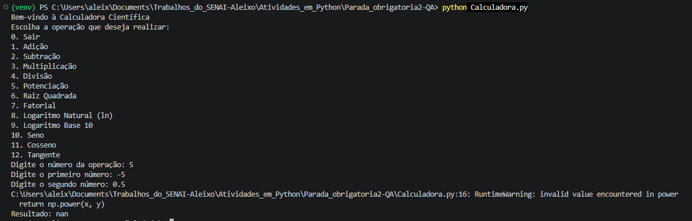

### Severidade e impacto
- **Severidade:** Médio
- **Impacto:** o usuário recebe `nan` sem explicação do motivo.

### Sugestões para correção (opcional)
Verificar `x < 0` com expoente não inteiro e retornar uma mensagem de erro.

### Registro e acompanhamento
- **Data de identificação:** 06/11/2026
- **Status:** Não resolvido

---

## BUG-09 — Seno listado no menu, mas não implementado

### Identificação
- **Título:** Opção 10 (Seno) cai em "Operação inválida"
- **Localização:** `Calculadora.py`, `menu` (linha 52, opção 10) e `calculadora_cientifica` (linhas 89–97, sem `elif escolha == '10'`). A função `seno` também não existe.

### Descrição detalhada
- **Descrição clara:** o menu oferece "10. Seno", mas não há ramo que trate a opção nem uma função `seno`. Escolher a opção exibe "Operação inválida", embora ela esteja listada como disponível.
- **Contexto:** opção 10 do menu.

### Passos para reproduzir
1. Execute `python Calculadora.py`.
2. Digite `10` (Seno).
- **Consistência:** ocorre sempre.

### Resultado esperado vs. obtido
- **Esperado:** o programa pede um ângulo em graus e mostra o seno (por exemplo, seno de 30° = 0.5).
- **Obtido:** `Operação inválida. Tente novamente.`

### Evidências
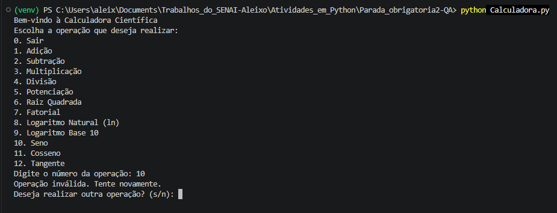

### Severidade e impacto
- **Severidade:** Alto
- **Impacto:** uma função anunciada no menu não existe. O seno não pode ser calculado.

### Sugestões para correção (opcional)
Criar a função `seno` e o ramo `elif escolha == '10'`, no mesmo padrão do cosseno e da tangente (ângulo em graus).

### Registro e acompanhamento
- **Data de identificação:** 06/11/2026
- **Status:** Não resolvido

---

## BUG-10 — Cosseno chama função inexistente

### Identificação
- **Título:** Opção 11 (Cosseno) falha com `NameError`
- **Localização:** `Calculadora.py`, função `calculadora_cientifica` (linha 95, `cosseno(x)`)

### Descrição detalhada
- **Descrição clara:** o ramo da opção 11 chama `cosseno(x)`, mas essa função não foi definida no arquivo. A execução termina com `NameError`.
- **Contexto:** opção 11 do menu, com o ângulo 45 graus.

### Passos para reproduzir
1. Execute `python Calculadora.py`.
2. Digite `11` (Cosseno).
3. Digite `45`.
- **Consistência:** ocorre sempre.

### Resultado esperado vs. obtido
- **Esperado:** `Resultado: 0.7071067811865476`
- **Obtido:** o programa é encerrado com exceção.

### Evidências
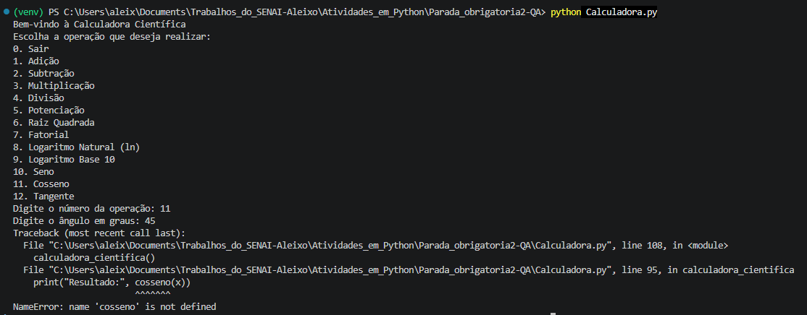

Log de erro:
```
File "...\Calculadora.py", line 95, in calculadora_cientifica
    print("Resultado:", cosseno(x))
NameError: name 'cosseno' is not defined
```

### Severidade e impacto
- **Severidade:** Alto
- **Impacto:** a operação não funciona para nenhuma entrada, e o programa é encerrado.

### Sugestões para correção (opcional)
Implementar `cosseno(x)` convertendo graus para radianos (`np.cos(np.radians(x))`).

### Registro e acompanhamento
- **Data de identificação:** 06/11/2026
- **Status:** Não resolvido

---

## BUG-11 — Tangente chama função inexistente

### Identificação
- **Título:** Opção 12 (Tangente) falha com `NameError`
- **Localização:** `Calculadora.py`, função `calculadora_cientifica` (linha 99, `tangente(x, radianos=False)`)

### Descrição detalhada
- **Descrição clara:** o ramo da opção 12 chama `tangente(x, radianos=False)`, mas a função não existe. A chamada também indica uma assinatura com o parâmetro `radianos`, que ainda não foi implementada. A execução termina com `NameError`.
- **Contexto:** opção 12 do menu, com o ângulo 90 graus.

### Passos para reproduzir
1. Execute `python Calculadora.py`.
2. Digite `12` (Tangente).
3. Digite `90`.
- **Consistência:** ocorre sempre.

### Resultado esperado vs. obtido
- **Esperado:** a tangente de 90° não é definida, então o programa deveria mostrar uma mensagem de erro. Para outros ângulos (por exemplo 45°) o resultado deveria ser `1.0`.
- **Obtido:** o programa é encerrado com exceção.

### Evidências


Log de erro:
```
File "...\Calculadora.py", line 99, in calculadora_cientifica
    print("Resultado:", tangente(x, radianos=False))
NameError: name 'tangente' is not defined
```

### Severidade e impacto
- **Severidade:** Alto
- **Impacto:** a operação não funciona para nenhuma entrada, e o programa é encerrado.

### Sugestões para correção (opcional)
Implementar `tangente(x, radianos=False)` com conversão de graus para radianos e tratamento dos ângulos 90° + k·180°, onde a tangente não existe.

### Registro e acompanhamento
- **Data de identificação:** 06/11/2026
- **Status:** Não resolvido

---

## BUG-12 — Entrada não numérica encerra o programa

### Identificação
- **Título:** Texto digitado no lugar de um número causa `ValueError`
- **Localização:** `Calculadora.py`, função `calculadora_cientifica` (por exemplo linha 78, `float(input(...))`). O mesmo padrão se repete nas linhas 64, 65, 82, 86, 90, 94 e 98.

### Descrição detalhada
- **Descrição clara:** as entradas são convertidas com `float(input(...))` (ou `int(input(...))`) sem tratamento de erro. Qualquer valor que não seja numérico encerra o programa com `ValueError`, em vez de mostrar uma mensagem e pedir o valor de novo.
- **Contexto:** opção 6 do menu (Raiz Quadrada), com o texto "numero". O mesmo padrão aparece nas demais operações, mas apenas a opção 6 foi testada.

### Passos para reproduzir
1. Execute `python Calculadora.py`.
2. Digite `6` (Raiz Quadrada).
3. Digite `numero` no lugar do número.
- **Consistência:** ocorre sempre.

### Resultado esperado vs. obtido
- **Esperado:** mensagem como `Entrada inválida`, com nova solicitação do valor.
- **Obtido:** o programa é encerrado com exceção.

### Evidências
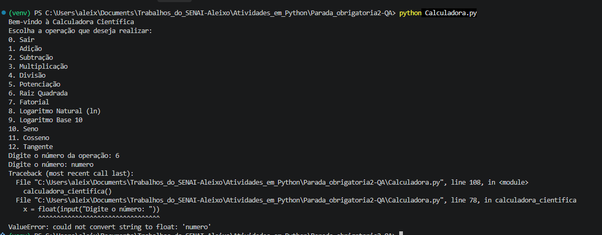

Log de erro:
```
File "...\Calculadora.py", line 78, in calculadora_cientifica
    x = float(input("Digite o número: "))
ValueError: could not convert string to float: 'numero'
```

### Severidade e impacto
- **Severidade:** Médio
- **Impacto:** um erro de digitação derruba a calculadora e o usuário perde o contexto.

### Sugestões para correção (opcional)
Envolver a leitura em `try/except ValueError` e pedir o valor novamente, de preferência em uma função auxiliar reutilizada por todas as operações.

### Registro e acompanhamento
- **Data de identificação:** 06/11/2026
- **Status:** Não resolvido

---

## BUG-13 — Importar o módulo executa a calculadora

### Identificação
- **Título:** Importar `Calculadora.py` abre o menu e trava à espera de `input`
- **Localização:** `Calculadora.py`, última linha (linha 108), chamada solta a `calculadora_cientifica()`

### Descrição detalhada
- **Descrição clara:** a chamada a `calculadora_cientifica()` está no nível do módulo, sem a proteção `if __name__ == "__main__":`. Por isso ela é executada sempre que o arquivo é importado, e não só quando ele é rodado diretamente. Qualquer `import Calculadora` (um teste, outro programa) abre o menu e fica esperando o usuário digitar. O módulo não pode ser reutilizado nem testado de forma automatizada.
- **Contexto:** identificado ao rodar o pytest pela primeira vez, com um teste que faz `from Calculadora import adicao`. Executar `python Calculadora.py` diretamente não é afetado. Ver "Ambiente de teste".

### Passos para reproduzir
1. Crie o arquivo `test_calculadora.py` na mesma pasta do `Calculadora.py`, com a linha `from Calculadora import adicao`.
2. Execute `python -m pytest -v`.
- **Consistência:** ocorre sempre.

### Resultado esperado vs. obtido
- **Esperado:** o import só carrega as funções, e o pytest coleta e executa os testes.
- **Obtido:** o menu da calculadora é exibido durante a coleta, e o pytest termina com `OSError: pytest: reading from stdin while output is captured!` e `1 error during collection`. Nenhum teste é executado.

### Evidências
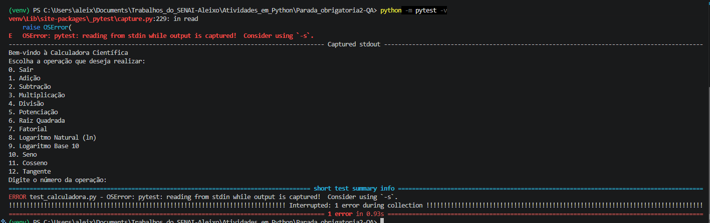

Log de erro:
```
OSError: pytest: reading from stdin while output is captured!  Consider using `-s`.
ERROR test_calculadora.py - OSError: pytest: reading from stdin while output is captured!
Interrupted: 1 error during collection
```

### Severidade e impacto
- **Severidade:** Médio
- **Impacto:** não afeta quem executa a calculadora diretamente, mas impede qualquer teste automatizado e qualquer reutilização das funções em outro arquivo. Foi o primeiro obstáculo ao aplicar TDD.

### Sugestões para correção (opcional)
Proteger a chamada com `if __name__ == "__main__":`.

### Registro e acompanhamento
- **Data de identificação:** 07/11/2026
- **Status:** Não resolvido