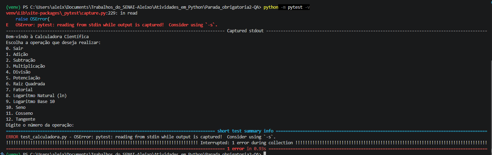
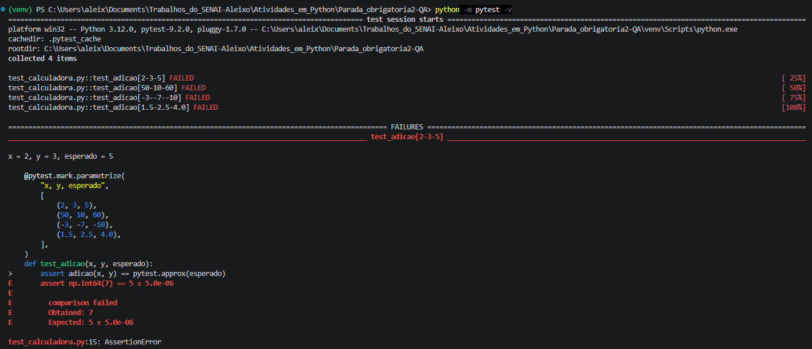
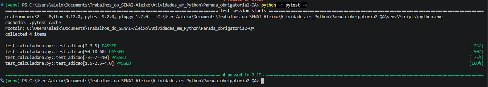
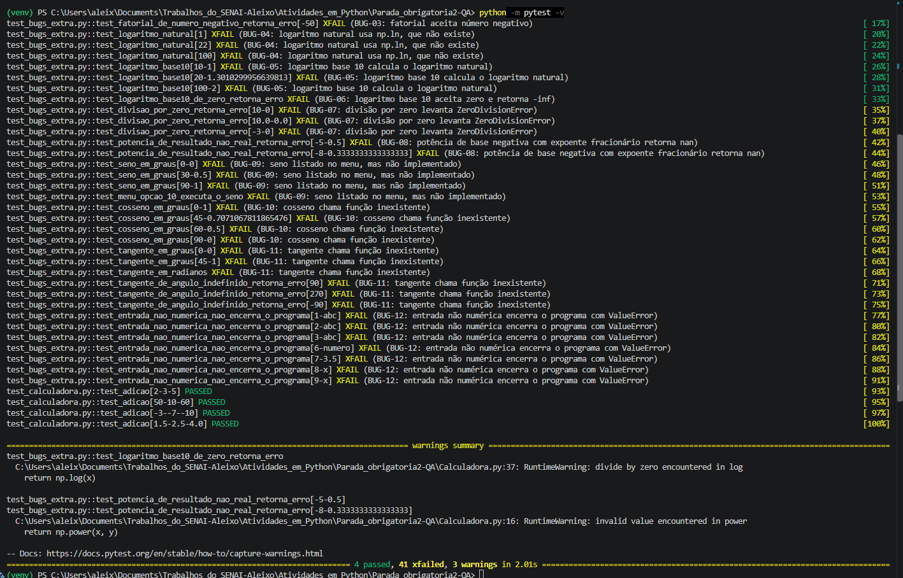

# Correção do BUG-01 com TDD — Adição retorna 2x + y

**Bug corrigido:** BUG-01, descrito em [`Bugs.md`](Bugs.md)
**Arquivo alterado:** `Calculadora.py`
**Arquivo de testes:** `test_calculadora.py`
**Framework de testes:** pytest
**Data da correção:** 07/11/2026

## Resumo

A função `adicao` fazia `x + np.add(x, y)`, que equivale a `2x + y`. O bug foi corrigido seguindo o ciclo do TDD: primeiro um teste que falha (vermelho), depois a menor correção possível para ele passar (verde) e por fim a refatoração com os testes ainda passando.

## 1. Compreensão do bug

- **Esperado:** `adicao(50, 10)` retorna `60`.
- **Obtido:** `adicao(50, 10)` retorna `110`.
- **Causa:** a linha 4 soma `x` duas vezes, uma fora e outra dentro de `np.add(x, y)`.
- **Impacto:** a operação mais básica da calculadora devolve um valor errado e não mostra nenhum erro (severidade crítica).
- **Reprodução original:** `evidencias/Bug_soma.png`, com o código ainda no estado do commit inicial.

## 2. Preparação do ambiente de teste

O pytest foi instalado no mesmo `venv` do projeto (`pip install pytest`).

### Problema encontrado: o módulo não pode ser importado (BUG-13)

Este problema foi registrado como BUG-13 em [`Bugs.md`](Bugs.md) e corrigido aqui, por ser pré-requisito para qualquer teste.

O arquivo termina com uma chamada solta a `calculadora_cientifica()`. Isso faz o menu abrir e pedir `input` no momento do `import`. Como o teste precisa fazer `from Calculadora import adicao`, o pytest falha antes de executar qualquer teste, durante a coleta:

```
OSError: pytest: reading from stdin while output is captured!
ERROR test_calculadora.py
Interrupted: 1 error during collection
```



### Solução

A chamada passou a rodar só quando o arquivo é executado diretamente:

```python
if __name__ == "__main__":
    calculadora_cientifica()
```

Executar `python Calculadora.py` continua se comportando como antes. Essa mudança não altera nenhuma operação matemática e foi feita em um commit separado da correção do bug.

## 3. Fase vermelha: teste que falha

O teste reflete o comportamento esperado que o bug viola. Ele cobre o cenário reportado (50 + 10), números pequenos, negativos e decimais:

```python
import pytest

from Calculadora import adicao


@pytest.mark.parametrize(
    "x, y, esperado",
    [
        (2, 3, 5),
        (50, 10, 60),
        (-3, -7, -10),
        (1.5, 2.5, 4.0),
    ],
)
def test_adicao(x, y, esperado):
    assert adicao(x, y) == pytest.approx(esperado)
```

Comando: `python -m pytest -v`

**Resultado:** os 4 casos falharam por asserção, e o valor obtido confirma a fórmula `2x + y`:

| x | y | Esperado | Obtido |
|---|---|---|---|
| 2 | 3 | 5 | 7 |
| 50 | 10 | 60 | 110 |
| -3 | -7 | -10 | -13 |
| 1.5 | 2.5 | 4.0 | 5.5 |



## 4. Fase verde: correção mínima

Foi removido o `x +` que somava `x` duas vezes. Nada mais foi alterado nesta etapa.

```diff
 def adicao(x, y):
-    return x + np.add(x, y)
+    return np.add(x, y)
```

Foi mantido `np.add` para seguir o estilo das outras funções do arquivo (`np.multiply`, `np.power`).

**Resultado:** os 4 casos passaram.



## 5. Refatoração

Com os testes passando, a única melhoria feita foi documentar a função com uma docstring. A lógica ficou intacta.

```python
def adicao(x, y):
    """Retorna a soma de x e y."""
    return np.add(x, y)
```

Os testes foram executados de novo depois da refatoração e continuaram passando.

## 6. Verificação final

- **Suíte de testes:** `python -m pytest -v` com todos os testes passando.
- **Risco de novos bugs:** a correção alterou uma única linha de lógica (`adicao`) e acrescentou a proteção do `__main__`. As demais funções não foram tocadas.
- **Revisão de código:** revisão do `git diff` antes do commit.

## 7. Testes dos demais bugs (BUG-02 a BUG-12)

Os outros 11 bugs não foram corrigidos, mas cada um tem testes em `test_bugs_extra.py` que descrevem o comportamento **esperado**. Isso deixa os bugs registrados de forma executável, e cada um já tem o teste que será a fase vermelha de uma futura correção.

- **Marcador `xfail(strict=True)`:** enquanto o bug existe, o teste falha de propósito. A suíte fica verde e o relatório mostra o motivo (por exemplo, `BUG-04: logaritmo natural usa np.ln, que não existe`).
- **Aviso ao corrigir:** quando um bug for corrigido, o teste passa e a suíte acusa falha. Isso indica que o marcador `xfail` daquele teste deve ser removido.
- **Padrão de erro:** erros de domínio (divisão por zero, fatorial negativo, log de zero, entre outros) devem retornar uma string que começa com `Erro`, como já faz `raiz_quadrada`.

| Bug | Comportamento esperado verificado |
|---|---|
| BUG-02 | `fatorial(0, 1, 5, 9, 50)` igual a `math.factorial` |
| BUG-03 | `fatorial` de negativo retorna `Erro...` |
| BUG-04 | `logaritmo_natural` igual a `math.log` |
| BUG-05 | `logaritmo_base10(10) = 1`, `(20) ≈ 1,3010`, `(100) = 2` |
| BUG-06 | `logaritmo_base10(0)` retorna `Erro...` |
| BUG-07 | `divisao` por zero retorna `Erro...` |
| BUG-08 | `potencia(-5, 0.5)` retorna `Erro...` |
| BUG-09 | `seno` em graus e opção 10 do menu sem "Operação inválida" |
| BUG-10 | `cosseno` em graus (0°, 45°, 60°, 90°) |
| BUG-11 | `tangente` em graus e radianos, e `Erro...` para 90°, 270° e -90° |
| BUG-12 | texto ou decimal no lugar do número não causa `ValueError` |

Para conferir que os testes estão corretos, eles foram executados contra uma versão de referência com todos os bugs corrigidos, e os 45 testes passaram. Para ver todos os testes falhando de verdade no código atual, use `python -m pytest --runxfail`.

Resultado no código atual: `4 passed, 41 xfailed`.



## 8. Commits

| Ordem | Mensagem | Conteúdo |
|---|---|---|
| 0 | `docs: registra BUG-13, importar o módulo executa a calculadora` | registro do bug em `Bugs.md` |
| 1 | `fix: corrige BUG-13, protege a execução da calculadora com __main__` | preparação do ambiente de teste |
| 2 | `test: adiciona testes que reproduzem o BUG-01 (adição)` | fase vermelha |
| 3 | `fix: corrige BUG-01, adição retornava 2x + y` | fase verde |
| 4 | `refactor: adiciona docstring em adicao` | refatoração |
| 5 | `test: adiciona testes xfail para os bugs 02 a 12` | testes dos demais bugs |
| 6 | `docs: adiciona Correcao.md e marca BUG-01 como resolvido` | documentação |

## 9. Status

O BUG-01 e o BUG-13 estão **Resolvidos**. O status foi atualizado em [`Bugs.md`](Bugs.md). Os bugs 02 a 12 continuam **Não resolvidos**, cada um com seu teste documentado.